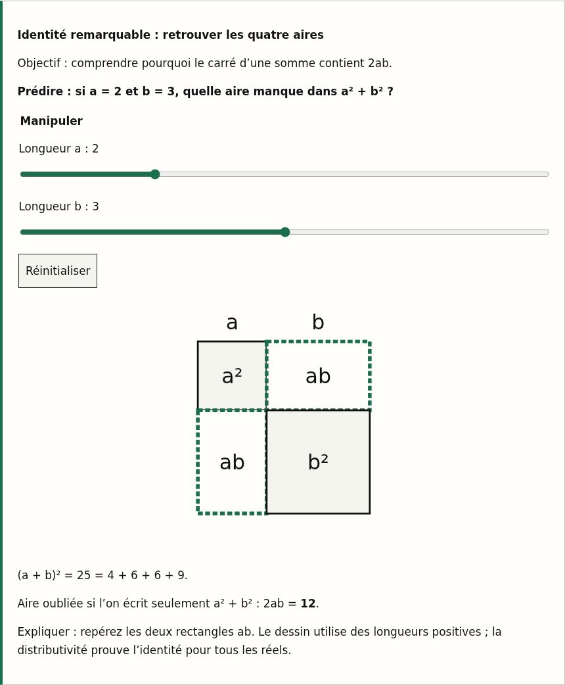
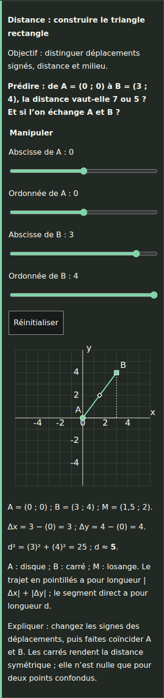

# L21–L27 — guided algebra and coordinate lessons

Initial implementation record. The [methods follow-up](L21_L27_METHODS_REVIEW.md) documents the additional seven islands and current reading versions.

Review date: 2026-10-28. Basis: `main` at `08ae1e5` (see Git history for the exact parent), all fourteen FR/EN reading sources, Astro configuration, shared reading layout and Chapter 2 teaching assets. The public URLs could not be retrieved through the web reader. The branch was subsequently rebased onto main `7ffe575` (L04 and L07 updates) and checked again. The repository and local production rendering are the review sources; the original PDF was unavailable. Existing source-page references and examples are retained, without asserting a new comparison with the PDF.

Review type: AI-assisted mathematical and translation author self-check, **not independent peer review**, human translation approval, physical-device acceptance or hosted classroom acceptance. New explanations, diagrams and activities are original project work.

## Passage-specific assessment and priorities

| Lesson and objective | Passage / barrier before the change | Result and priority |
| --- | --- | --- |
| L21: reliable real arithmetic | “Le contrat de calcul” packs the whole hierarchy into one paragraph; “Ce qui change et ce qui reste” names commutativity/associativity without showing their notation. Prerequisite is only L10. | P1: concrete prerequisite reminder, explicit laws, calculation checklist and regrouping explorer. Signed-power example and zero-division counterexample retained. |
| L22: change form for a purpose | “Reconstruire les identités” is a short instruction after completed formulas. Static area diagram cannot be changed. “Terme” does not specify the expression level. | P1: choose-form procedure; define outermost terms; manipulate four square/rectangle areas and explain the missing cross term. |
| L23: conditions on fractions, powers and roots | “Une formule simplifiée garde ses restrictions” explains the excluded point without letting the learner encounter it. Three families of operations can blur together. | P1: operation-specific method and domains table. Deliberately test 3, 0 and negative inputs; show a hole, real-root failure, absolute value and reciprocal restriction. |
| L24: preserve a complete solution set | “Inégalités et intervalles” compresses direction, bound and interval translation. Domain and squaring warnings have little immediate practice. | P1: isolate/check method, movable inequality including a=0, open/closed endpoint, candidate rejection after squaring. |
| L25: solve simultaneous conditions | “Trois issues possibles” lists contradiction, identity and unique result without a visual comparison. Parameter division can hide a case. | P1: optional coordinate primer, adjustable line system and elimination equation; retain an original equation, then verify both. |
| L26: unfold sigma and explain centering | “Moyenne et écarts” places the proof in one equality chain. Source-defined index bounds are easy to count incorrectly. | P1: four justified proof steps, editable observation count and values, explicit indexed sum and exact centered identity; distinguish rounded displays from exact mathematics. |
| L27: distinguish displacement and distance | “Déplacement et longueur” and “Attention aux échelles” introduce sign, orthonormality and physical units in quick succession. | P1: adjustable equal-scale triangle, signed differences, midpoint and direct-versus-right-angle route; worked unit-conversion exercise. |

P0 correctness risks are conditions rather than incorrect numerical answers: never remove a quotient hole, divide by zero, silently reverse an inequality, discard a parameter case or apply raw-coordinate Pythagoras with unequal physical units. These conditions are preserved and exercised explicitly. No new derivative material is inserted: these seven lessons are prerequisites in Chapter 2, not the derivative lessons of Chapter 3.

The site learning order is L21 → L22 → L23 → L24 → L25 → L26 → L27. Source-document links jump back from L23 to L22; L22 now distinguishes that optional document order from the recommended site sequence. L25’s graph anticipates coordinates: a short optional primer prevents making L27 a circular prerequisite. Definitions and calculations still work without reading the graph. L26’s averages connect to L27’s midpoint. Existing section names/anchors, examples, diagrams and PDF markers are retained.

## Rewritten material

Every lesson now opens with a motivating problem and a targeted prerequisite refresher, then adds a reusable “Comment faire ?” procedure, a misconception/counterexample, three graduated public written exercises with separate native hint and solution disclosures, and a printable essentials/self-check page. There are 21 added practice tasks; these are ungraded lesson examples, separate from authenticated practice banks. Reading time estimates increase by 15 minutes to include the activities and practice.

Examples of substantive clarification:

- L21 spells out the meaning of commutative and associative with both addition and multiplication formulas; a number-family guide supports the real-number notation.
- L23 asks for the original domain before factoring; a simplified expression never supplies an excluded original input.
- L24 separates the nonnegative-radicand requirement from the nonnegative right side of a square-root equation, then rejects the extraneous negative candidate in the original equation.
- L25 explains why retaining only the difference of two equations loses a condition.
- L26 fixes the data list while proving that its mean is a constant, applies linearity, and substitutes the two equal totals in four separate steps.
- L27 explains why summing absolute coordinate changes measures a right-angled path rather than the straight segment.

## Interaction specifications

All controls are native labeled inputs with visible keyboard focus and reset. Ranges support arrows/Home/End and touch. SVG diagrams have accessible names and matching text/equations; line patterns and point shapes supplement color. There is no animation or autoplay. Relevant results announce changes politely. Values are rounded to four decimal places, with scientific notation for very small/large finite results; numerical overflow is identified as a precision limitation, not as a real infinite answer.

| Island / location | Manipulation | Synchronized result / learning question | Defaults and boundaries |
| --- | --- | --- | --- |
| L21 after signed-power examples | a, b, c and a grouping checkbox | Formula, first calculation, second calculation and comparison. Which operation becomes first? Does a single agreement prove an identity? | 2,3,4; ungrouped. Integers −5…5; all operations defined. |
| L22 beside identity-area explanation | Positive lengths a and b | Four accurate fixed-scale areas, total square and missing 2ab. Which two rectangles disappear in the false formula? | a=2,b=3; integer lengths 1…5. Positive-length drawing is not claimed as proof for negative lengths. |
| L23 beside restricted simplification | Real x in [−5;5] | Quotient graph with open hole; table for quotient, root, root of square and reciprocal. Can cancellation restore x=3? | x=2. Empty/nonfinite/out-of-range input suppresses live results; undefined mathematical values remain explicitly undefined. |
| L24 beside inequality/interval explanation | Integer a,c; test x; strict/inclusive choice | Reversible step, interval, ray, bound inclusion and direct-substitution test. What changes when a changes sign or becomes zero? | a=−2,c=4,x=0,strict. Coefficients −4…4, test −5…5. a=0 yields all/none without division. |
| L25 after three outcomes | Integer m and b in y=mx+b; fixed y=x+1 | Two labeled/patterned lines, elimination and verified intersection or all/none classification. Does m=1 alone count solutions? | m=−1,b=3. m=−2…3,b=−3…3; every offered unique intersection is inside the plotted window. |
| L26 after centered proof and mean figure | n=1…4 and each observation | Expanded sigma sum, mean, signed-deviation table/diagram and exact centered-sum identity. How does a unit change affect the mean? | n=3; 2,5,8; fourth value 5. Each integer observation −5…10. Empty samples cannot be selected; rounding note prevents a false exact-decimal claim. |
| L27 beside triangle explanation | Both coordinates of A and B | Equal-scale graph, right triangle, midpoint, signed differences and Pythagorean distance. Does exchanging direction change distance? | A=(0,0), B=(3,4); integer coordinates −4…4. Vertical/horizontal/zero-length cases require no division. |

Each interaction is server-rendered with defaults, including its diagram/table. Controls appear only after hydration. A separately rendered fixed reference state is used in print, even after manipulation or invalid input. Native disclosures still work without JavaScript; print styles expand hints and solutions. Print colors, layout and math are scoped to these seven lessons; unnecessary navigation/controls are hidden. Existing static illustrations are retained.

## Architecture and release decision

React, MDX, remark-math and KaTeX were already installed and configured. Reading remains in the Astro `lessons` content collection; fourteen `.md` sources become `.mdx` with one `client:visible` island each. React is useful here for coordinating controls, multiple numeric explanations and SVG state, while a shared view supplies identical initial/print mathematics. No plotting library, dependency, lockfile or integration change is needed. The lesson template is unchanged; an unrelated lesson does not instantiate this island.

The English counterparts preserve heading depth/order, math strings, examples, domain conditions, controls and feedback meaning. Reading versions advance L21/L24/L25/L27 2→3 and L22/L23/L26 3→4. The release registry’s selected practice-bank versions and all immutable exercise archives remain unchanged. Bank self-check evidence remains the prior Chapter 2/lesson-clarity record; this document renews the changed reading/translation decision only and points to the existing evidence rather than claiming to re-review the banks. See [Chapter 2 review](CHAPTER_02_REVIEW.md), [source-alignment review](CHAPTER_02_SOURCE_ALIGNMENT_REVIEW.md) and [previous lesson-clarity review](LESSON_CLARITY_REVIEW_2026-10-23.md).

## Mathematical and bilingual author self-check

- Arithmetic: 2+3×4=14 versus (2+3)×4=20; signed fourth powers −16/16; counterexample 0×1=0×2 cannot cancel zero.
- Areas: a=2,b=3 gives 4+6+6+9=25; omitted cross area is 12. Factoring 2x²−8 expands back exactly; (x−3)² establishes nonnegativity on all reals.
- Domains: multiplying the simplified quotient by its original nonzero denominator recovers x²−9. At 3 it remains undefined. √x excludes negative x; √(x²)=|x|; reciprocal excludes zero.
- Inequalities: solved sets are compared to direct substitution across all offered a,c pairs and both boundary types, including boundary and either side. Zero coefficients compare the constant directly.
- Systems: each offered unique intersection is substituted in both equations. Equal slopes are classified by intercept equality; the parameter exercise retains all (t,2−t) when a=1.
- Means: conservation of total, centered-sum cancellation, singleton behavior and change of one observation by 1/n are checked. Weighted-group exercise gives 12, not 14.
- Distance: (3,4) gives 5; sign reversal and translation preserve length; midpoint is half the distance from each endpoint; coincident points give zero. Unequal physical units give √52, not 5.
- All 21 written solutions were read against their stems. French/English formulas are checked mechanically, and the paired instructions, hypotheses, exclusions, sign wording and units were read for meaning. No independent human approval is asserted.

## Validation

- Pinned Node 24.19.0 / pnpm 11.25.0; frozen-lockfile installation.
- `pnpm check`: passed after rebasing, including documentation/release/fingerprint/translation gates, zero Astro errors or warnings, formatting, **335 unit/content/repository tests**, and the Vercel production build. Existing unused-import hints are not described as errors.
- Full rebased `pnpm test:e2e`: **335 passed, 3 failed out of 338**. The only failures are French header checks at 1051px in chapter-navigation, reading and theme. All three reproduce on an unchanged worktree at `7ffe575` with a 1052px document width; the same three English checks pass. They are outside the lesson change and remain failures, not waived assertions. No merge readiness or green full browser gate is claimed.
- Final targeted run: `pnpm test:e2e tests/e2e/algebra-explorers.spec.ts tests/e2e/chapter-two-practice.spec.ts`: **25/25 passed** after the print grouping change, including fixed default print results after live manipulation/invalid input and saved Chapter 2 practice compatibility.
- All seven routes and activities were inspected in local production output at 320/375/768/1440px; representative light/dark screenshots are below. No page exceptions were observed. Keyboard, touch, reset, domain failures, numerical precision limits, zero/parallel/coincident cases, paired anchors and no-JavaScript reading are covered by browser checks.
- Fourteen A4 outputs (both languages) were rendered and visually inspected. Text extraction confirmed all three explained solutions per lesson and checked horizontal text bounds. Question/hint/solution groups stay together; figures and tables remain intact. Fixed print states remain available after a changed grouping or invalid live input. The standalone revision sheet is deliberate. Temporary QA PDFs are not added to the publication.
- `node scripts/check-immutable-exercises.ts` and `git diff --check`: passed. Selected banks and all exercise archives are unchanged. The pre-existing source-path tests now use the repository’s `.md`/`.mdx` reader; the Chapter 2 browser expectation permits exactly one `client:visible` AlgebraExplorer island on L21–L27 and still requires no islands on L28–L36.
- Browser verification uses the already available temporary Chromium 153 via `PLAYWRIGHT_CHROMIUM_EXECUTABLE`; no browser package or project dependency was added.

Remaining limits: no original-PDF reinspection, independent mathematical/translation reviewer, manual screen-reader/physical-device test, deployed authentication acceptance, merge or production deployment.

## Representative screenshots

