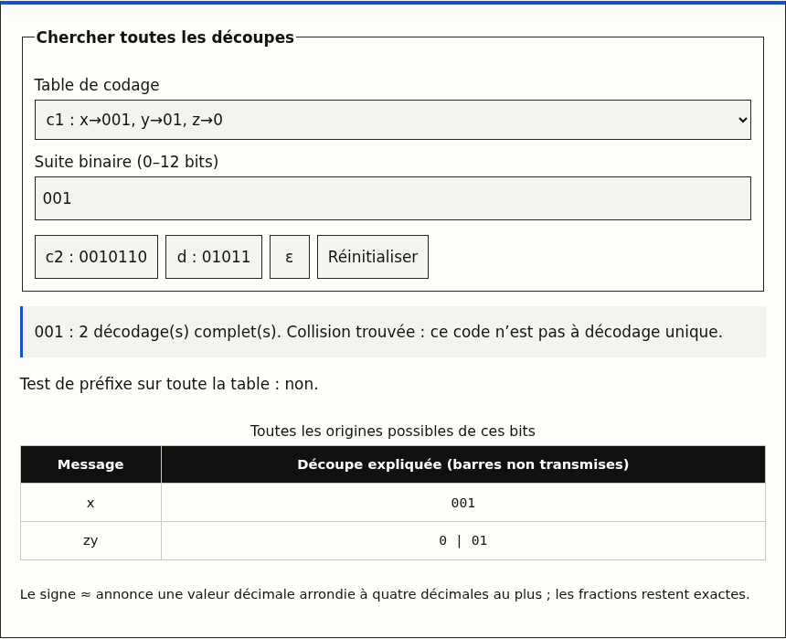
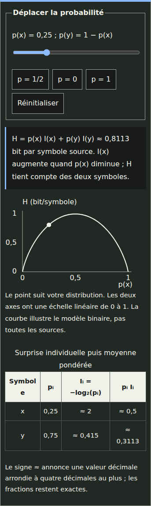
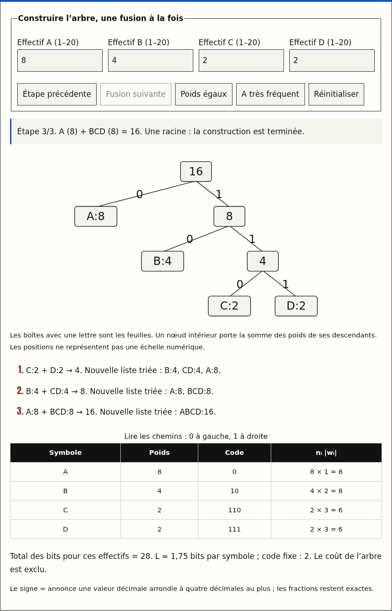

# L43–L49 — implemented activity previews

Local production rendering, 28 October 2026. These original screenshots show the French lesson islands. They do not establish hosted acceptance. See [the assessment and validation record](../../../content/L43_L49_LEARNING_REVIEW.md).

## L45 — complete alternative decodings

## L48 — surprise and entropy on a dark phone

## L49 — final Huffman tree and merge trace

