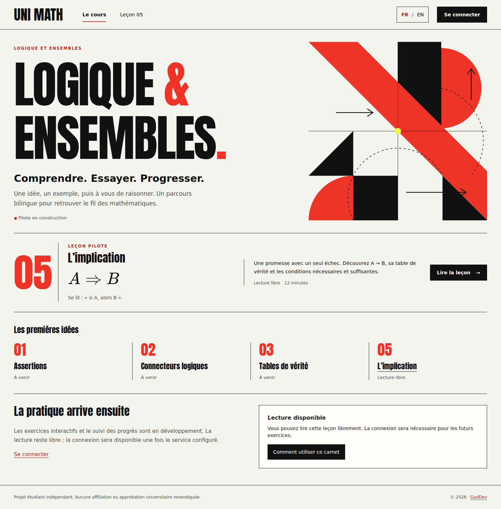
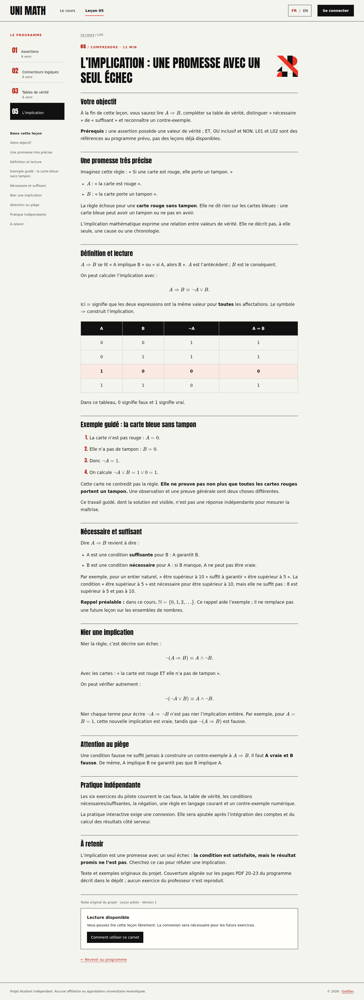
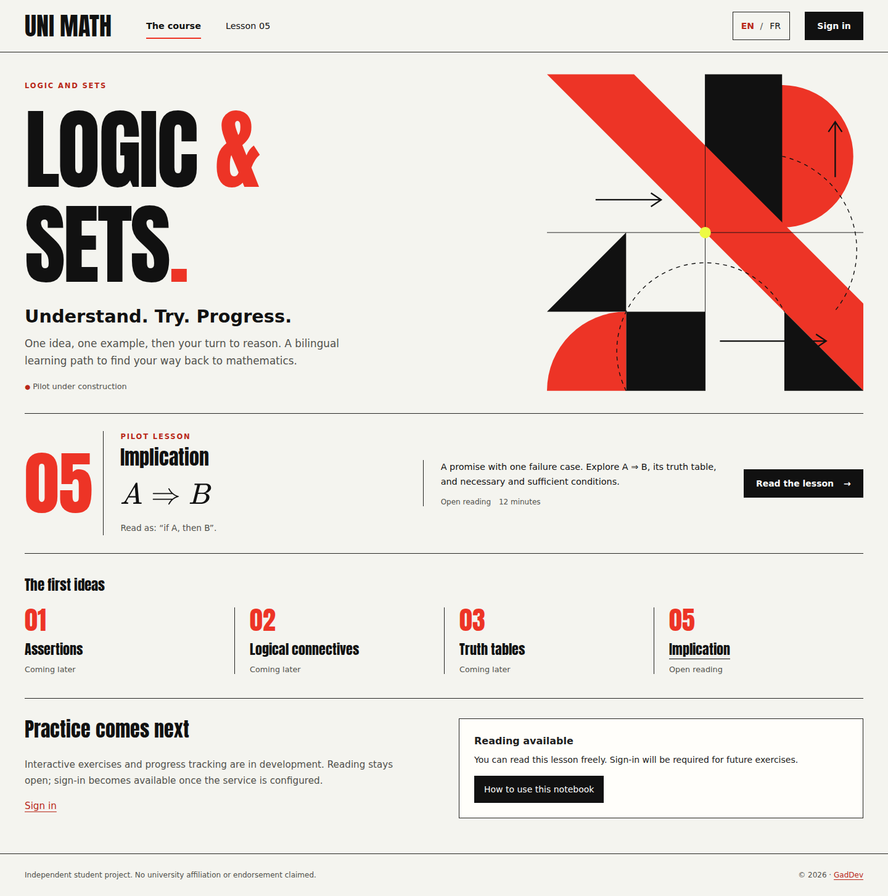
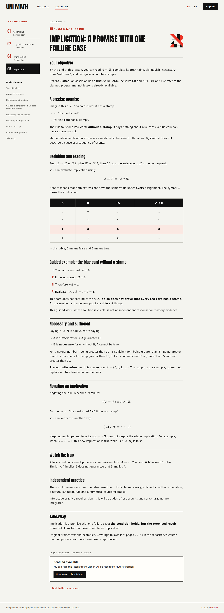
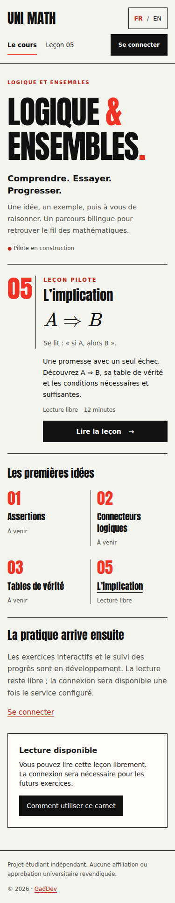
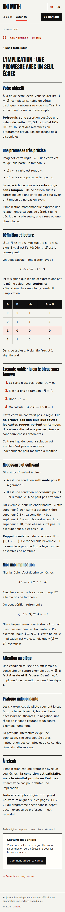

# Signal public reading review

## Implemented scope

This is the first implementation of the selected [Signal direction](../../proposals/README.md), following design PR #5. The public programme and original L05 implication lesson now share condensed display typography, black rules, vermilion accents, generous space and original geometric decoration. Reading stays quiet: body text uses system fonts and formulas retain KaTeX rather than display lettering.

The change adds no exercise delivery, grading or progress features. Planned topics remain labelled as coming later. The header links only to existing course, lesson and sign-in routes. The current language is a status label; the other language is a link. Existing authentication pages inherit the shared shell and colour tokens, without changes to authentication logic or providers.

The programme introduces the course, prerequisites, the available lesson and the development state of practice. The lesson adds a desktop outline and section navigation; on narrow screens, a native expandable contents control takes their place. Language switching preserves L05 and maps section fragments between the reviewed French/English heading pairs. Missing counterparts or heading count/depth mismatches fail the build. Translation meaning and heading order still require human review; these checks do not certify bilingual fidelity.

## Production screenshots

These lossless WebP captures show the actual local production build, not the earlier concept images. Their filenames identify viewport width; full-page heights vary with language and content. No mock learner data is used. The 375 px contents control is shown closed.

| Page | Language | Viewport width | WebP dimensions | Preview |
| --- | --- | --- | --- | --- |
| Programme | French | 1440 px | 1440 × 1464 px |  |
| L05 lesson | French | 1440 px | 1440 × 3956 px |  |
| Programme | English | 1440 px | 1440 × 1453 px |  |
| L05 lesson | English | 1440 px | 1440 × 3927 px |  |
| Programme | French | 375 px | 375 × 1932 px |  |
| L05 lesson | French | 375 px | 375 × 5184 px |  |

## Components and tokens

- Paper `#f4f4ef`, ink `#111111`, muted text `#51514c`, functional red `#b92819`, decorative/display red `#ed3426`, focus blue `#075cab`.
- Anton display face, self-hosted Latin subset under SIL OFL 1.1; Arial/Helvetica/system body text. No remote font service or new runtime dependency.
- Primary links use black rectangular surfaces. Active navigation has a rule and heavier text. Future lessons include a written status. The L05 false truth-table row retains its explicit `0` result and is also bold and tinted; colour carries no unique answer information.
- Header navigation has 44 px minimum height; primary links have 46 px minimum height. The language link has a 40 × 44 px target. Compact desktop section links retain readable text; mobile section links use larger targets.
- A two-row header at 860 px and below prevents long bilingual labels from colliding. The desktop course outline gives way to expandable contents. Decorative hero artwork is hidden at 500 px and below; lesson artwork remains small. All illustrations are decorative SVG with `aria-hidden` and no focus target.
- Skip link, visible 3 px focus outline, semantic landmarks, native links/details and the existing keyboard-operated Radix disclosure remain available. Equations emit HTML plus MathML; original plain-language readings remain in the lesson.

## Validation and limits

On 2026-10-14, `pnpm check` passed: repository/content checks, typechecking, formatting, all 12 unit tests and the Vercel production build. All 33 Chromium browser tests passed with `PLAYWRIGHT_CHROMIUM_EXECUTABLE=/tmp/design-chromium/chromium pnpm test:e2e --workers=1`. The first two-worker run identified the reading-tip grid stretching issue (fixed) and one cold-load timeout; the complete single-worker rerun passed. The repository's default two-worker setting is unchanged.

`pnpm check` covers repository/content validation, Astro/TypeScript checking, formatting, unit tests and the Vercel production build. `pnpm test:e2e` covers the local production Node build, existing authentication protocol/browser paths and the public reading regressions. The focused additions cover French/English header geometry and horizontal overflow at 320, 375, 768, 859, 860, 861, 1099, 1100, 1101, 1280 and 1440 px; corresponding section navigation during language switching; the mobile contents control; skip-link focus, visible focus and mathematical markup.

Palette calculations on the paper background give 17.11:1 for ink, 7.23:1 for muted text, 5.63:1 for functional red and 6.08:1 for focus blue. Decorative red gives 3.72:1 and is reserved for large display text or artwork, not normal-size reading text. These token calculations are not an audit of every rendered state.

Screen captures are checked for real WebP encoding, recorded dimensions, loaded display font, absence of browser page errors/dev toolbar and page-level horizontal overflow. Visual review checks typography, formulas, wrapping and component consistency in both languages and mobile layouts.

Actual screen-reader behaviour, browser text zoom/reflow, forced colours and deployed Vercel behaviour remain implementation acceptance checks. Static captures do not establish accessibility. No new mathematical content is published: the existing bilingual lesson, source references, domain conventions and exercise contracts are unchanged. Existing mathematical self-check evidence is not independent peer review.

## Constitution evidence and review decisions

| Principle | Evidence in this change | Limit or next decision |
| --- | --- | --- |
| Correct mathematics and source uncertainty | Original L05 text, truth table, plain readings and source references remain unchanged; KaTeX is retained. | No new disputed example or graded exercise; further content needs its documented review. |
| Authorship and rights | Original CSS/SVG; Anton licence and asset register recorded; concept artwork is not bundled into app pages. | Third-party course redistribution permission remains unverified. |
| French/English alignment | Shared lesson ID, equivalent routes, paired section mapping and build guards. | Human review of meaning/order remains necessary; stable section IDs would be preferable for a larger catalogue. |
| Supportive practice | Public reading and worked example stay available; practice is explicitly in development. | Practice, feedback and mistake review are separate future work. |
| Access and privacy | Public routes stay public; existing real sign-in route is linked. | No learner records or privacy policy changes; hosted authentication acceptance remains pending. |
| Authoritative results | No grading, rewards or mastery displays added. | Server grading, versioned attempts and mastery evaluation remain future work. |
| Accessibility and maintainability | Semantic navigation, focus/skip link, mobile layout, MathML, self-hosted font and no added package. | Assistive-technology/deployed acceptance is still required. |
| Deliberate changes | Scope and limits documented here and in the changelog. | Review Signal typography density, mobile header and lesson navigation before expanding practice. |
