# Application screen proposals

Status: draft visual direction, prepared 2026-10-14. All screens and counters are proposals or fictional fixtures; no application features are implemented.

Selected direction: **Annotated notebook** — warm paper, restrained teal, generous mathematical reading space and explanatory feedback.

## Review guide

- [Design brief and three-direction comparison](DESIGN_BRIEF.md)
- [Tokens, components and accessibility contracts](DESIGN_SYSTEM.md)
- [Original mathematics, bilingual review and answer contract](CONTENT_REVIEW.md)
- [Constitution-to-design checklist](CONSTITUTION_CHECKLIST.md)
- [Validation and reproduction](VALIDATION.md)
- [Machine-readable rendering evidence](render-evidence.json)

## Screen index

All widths are CSS viewports at device scale 1. Images are full-page lossless WebP exports; height follows content, rather than cropping a phone screen. The blue outline in unanswered practice deliberately illustrates keyboard focus on the hint control.

| Screen | Language | Viewport | Export |
| --- | --- | --- | --- |
| [Public course overview](images/01-overview-fr-1440.webp) | FR | 1440 px | 1440 × 1302 px |
| [Implication lesson](images/02-lesson-fr-1440.webp) | FR | 1440 px | 1440 × 1291 px |
| [Original worked example](images/03-worked-example-fr-1440.webp) | FR | 1440 px | 1440 × 1490 px |
| [Bilingual glossary](images/04-glossary-fr-1440.webp) | FR | 1440 px | 1440 × 1895 px |
| [Signed-in practice · unanswered](images/05-practice-unanswered-fr-1440.webp) | FR | 1440 px | 1440 × 1328 px |
| [Signed-in feedback · incorrect option C](images/06-feedback-incorrect-fr-1440.webp) | FR | 1440 px | 1440 × 1534 px |
| [Private progress and mistake review](images/07-private-progress-fr-1440.webp) | FR | 1440 px | 1440 × 1301 px |
| [Sign-in gate · unavailable preview](images/08-sign-in-gate-fr-1440.webp) | FR | 1440 px | 1440 × 1183 px |
| [French lesson · mobile](images/09-lesson-fr-375.webp) | FR | 375 px | 375 × 2059 px |
| [French practice · mobile](images/10-practice-unanswered-fr-375.webp) | FR | 375 px | 375 × 1662 px |
| [French feedback · mobile](images/11-feedback-incorrect-fr-375.webp) | FR | 375 px | 375 × 2459 px |
| [English lesson · desktop](images/12-lesson-en-1440.webp) | EN | 1440 px | 1440 × 1269 px |
| [English feedback · desktop](images/13-feedback-incorrect-en-1440.webp) | EN | 1440 px | 1440 × 1534 px |
| [French practice · narrow mobile](images/14-practice-unanswered-fr-320.webp) | FR | 320 px | 320 × 1775 px |

## Previews

Expand a screen to review its full-page image. Start with lesson → worked example → gate; practice, feedback and progress represent separate proposed signed-in states.

Public course overview · FR · 1440 px

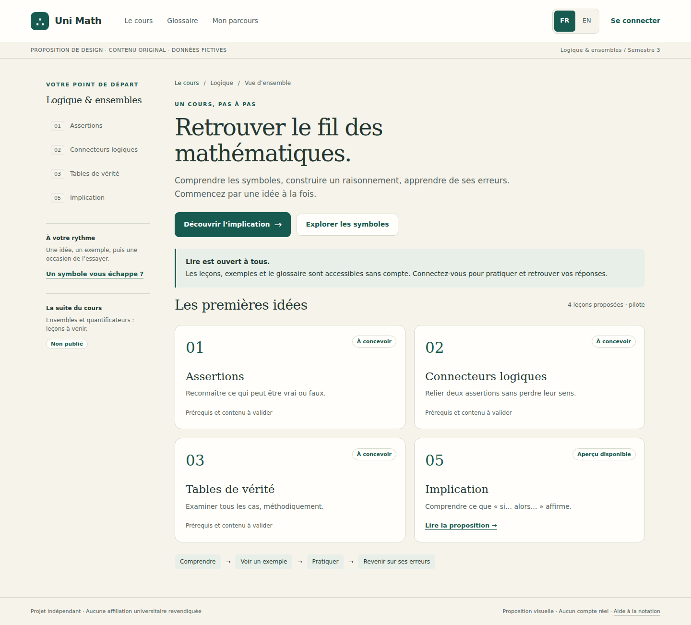

Implication lesson · FR · 1440 px

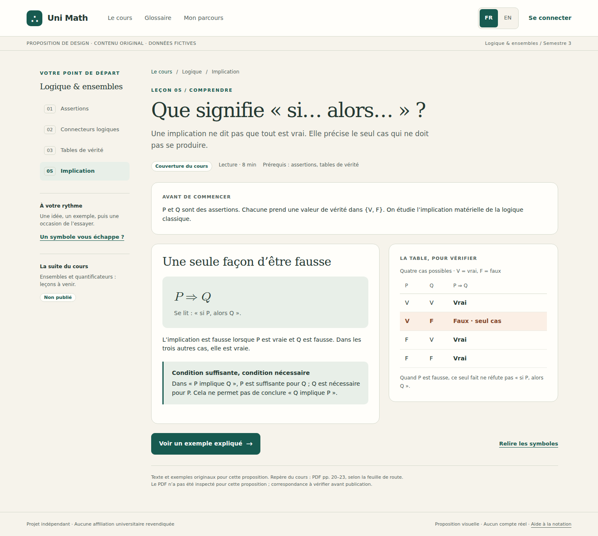

Original worked example · FR · 1440 px

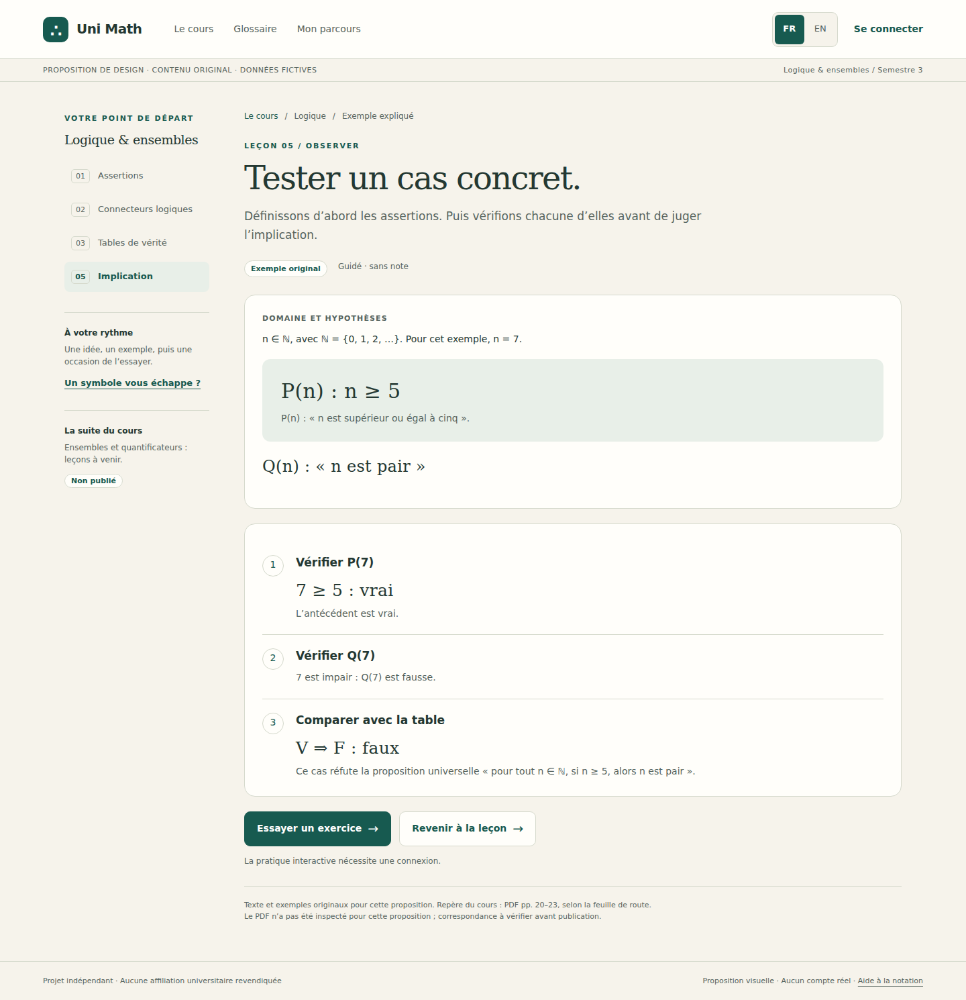

Bilingual glossary · FR · 1440 px

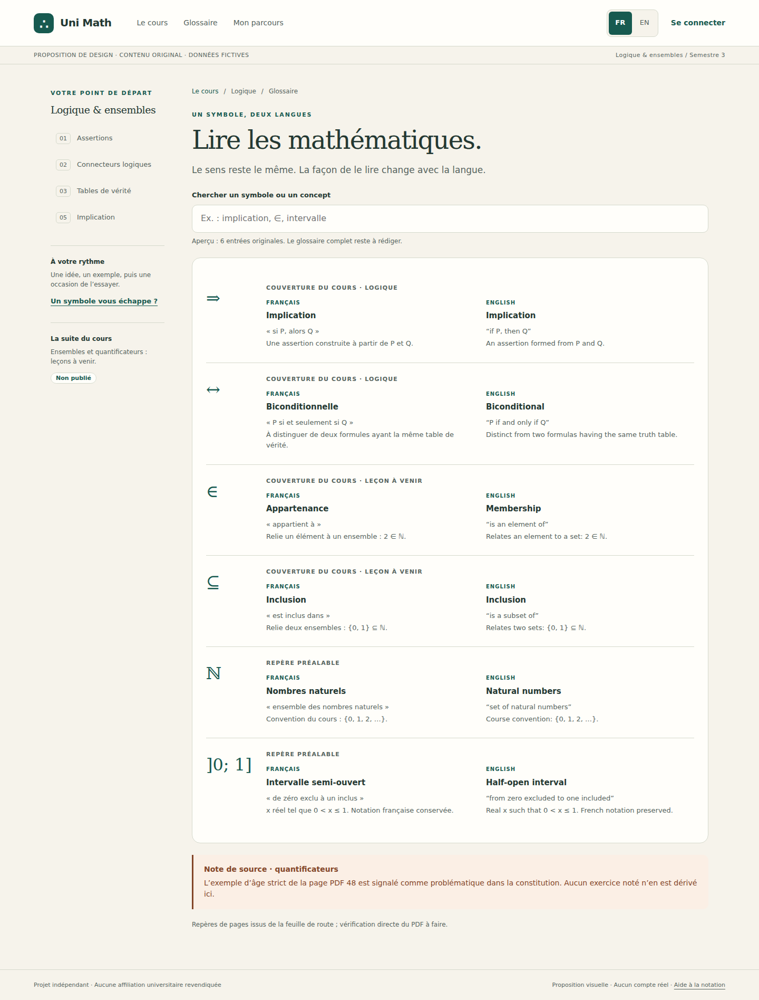

Signed-in practice · unanswered · FR · 1440 px

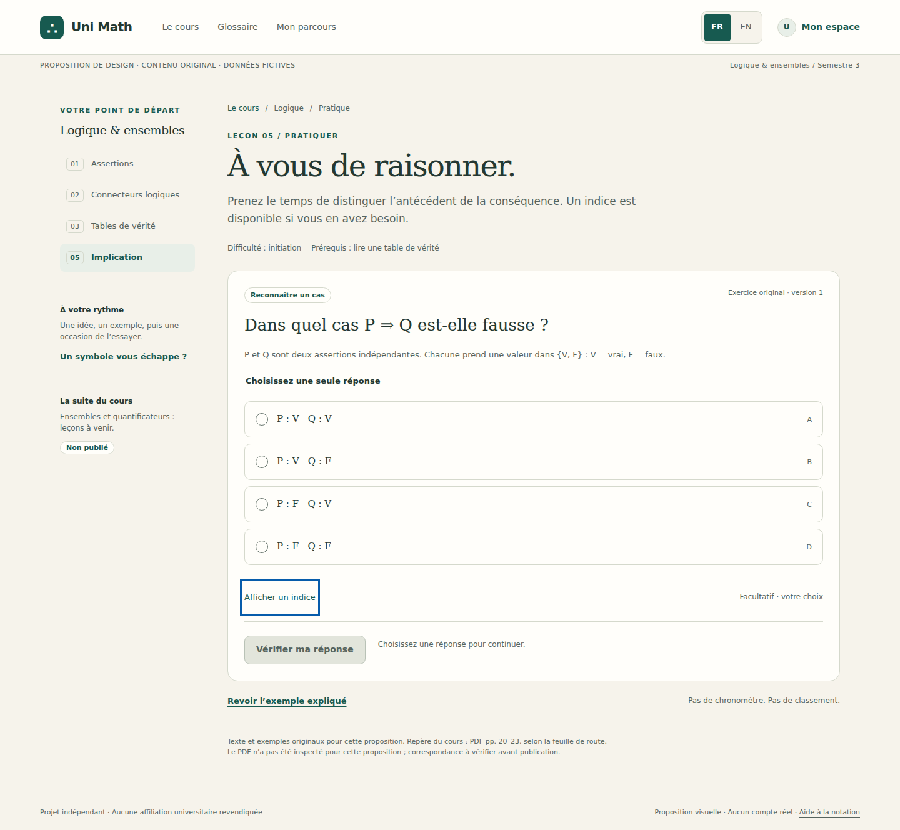

Signed-in feedback · incorrect option C · FR · 1440 px

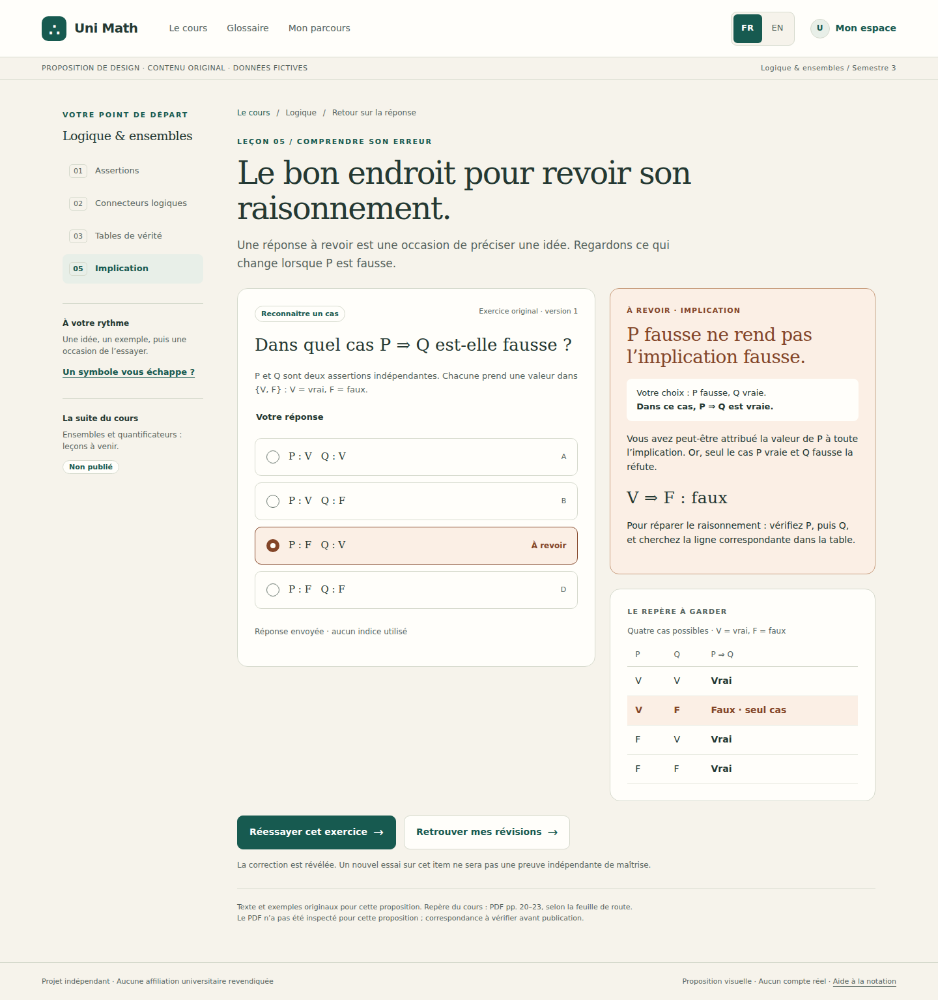

Private progress and mistake review · FR · 1440 px

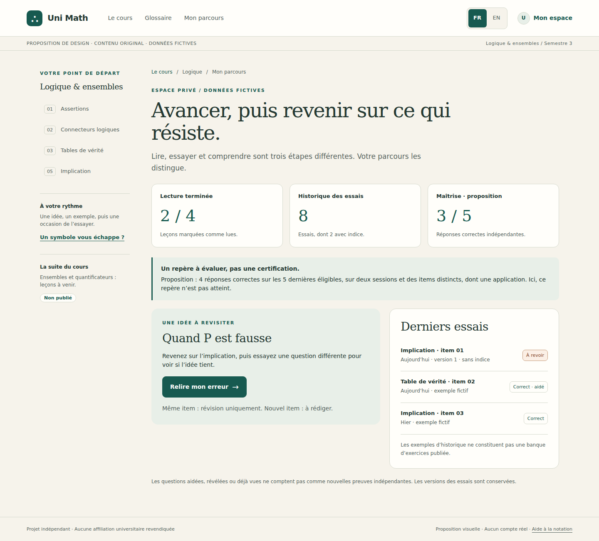

Sign-in gate · unavailable preview · FR · 1440 px

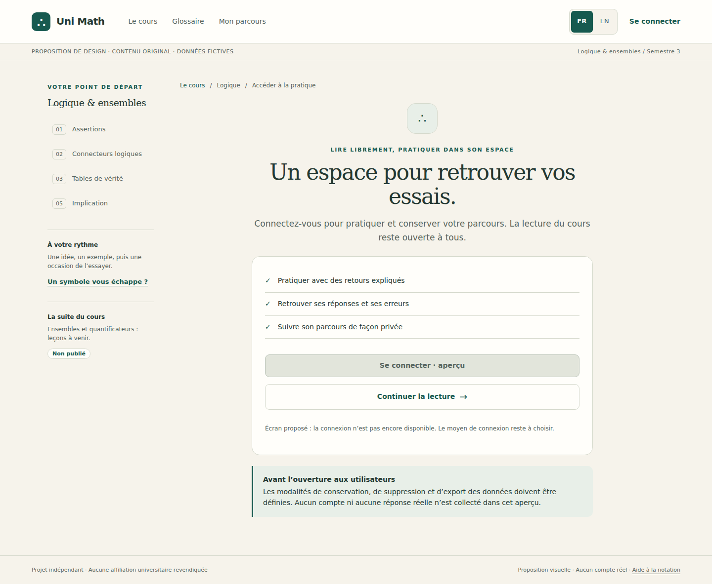

French lesson · mobile · FR · 375 px

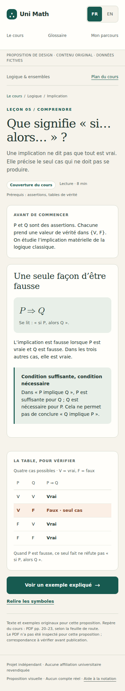

French practice · mobile · FR · 375 px

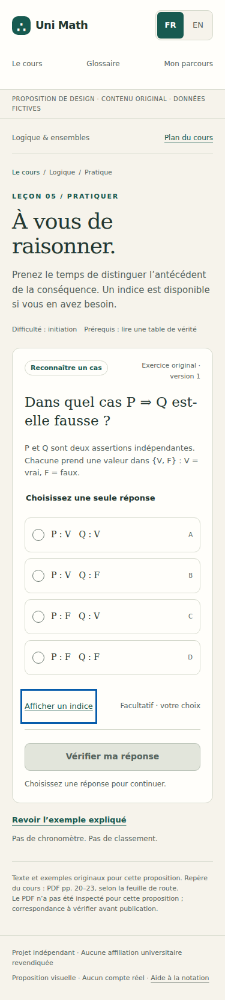

French feedback · mobile · FR · 375 px

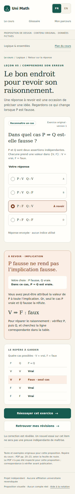

English lesson · desktop · EN · 1440 px

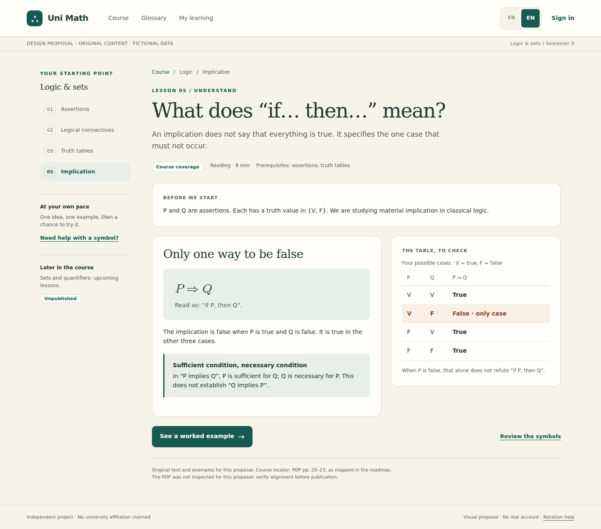

English feedback · desktop · EN · 1440 px

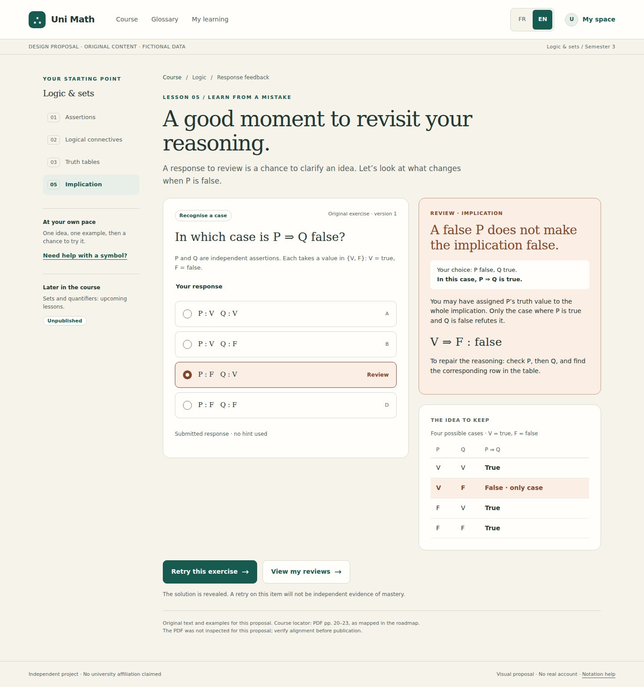

French practice · narrow mobile · FR · 320 px

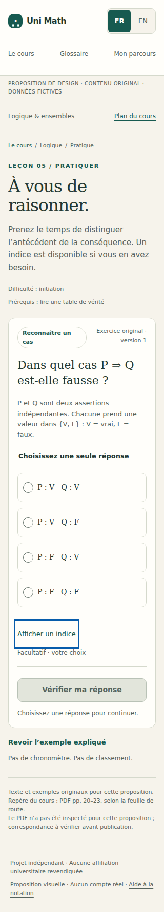

## Review priorities

Confirm the visual direction, mobile feedback length and bilingual glossary. Approve original mathematical content and source mapping before publication. Select authentication and data policies before real practice. Evaluate the proposed mastery heuristic during the pilot. See the checklist for the implementation gates.
