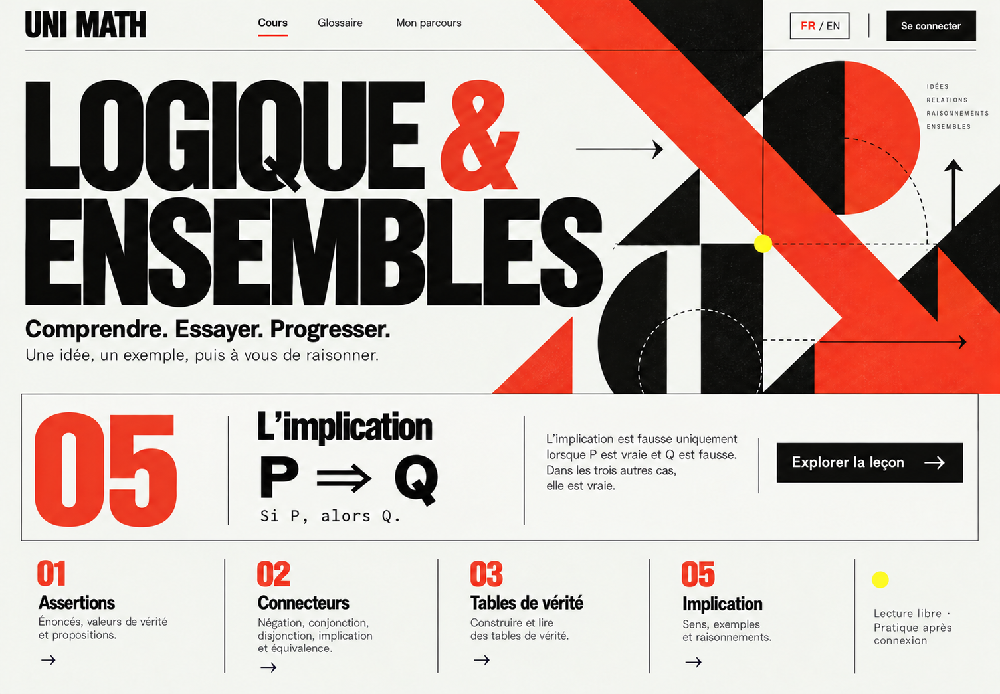
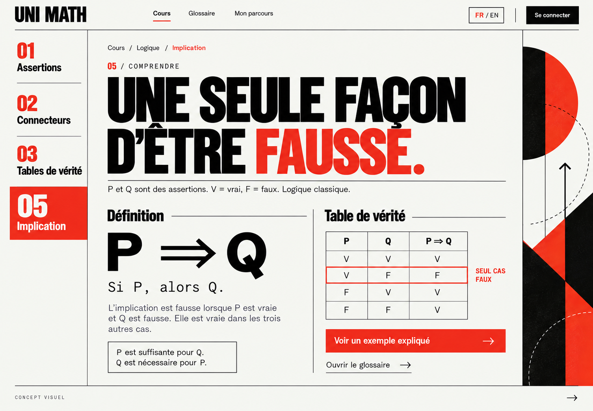
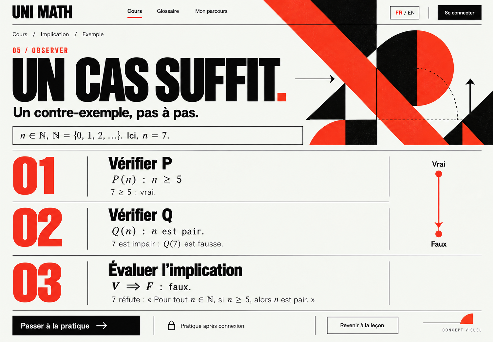
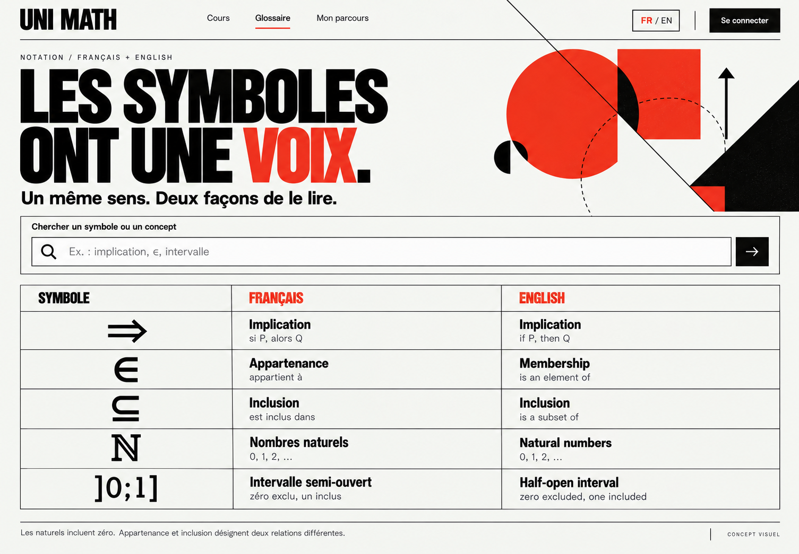
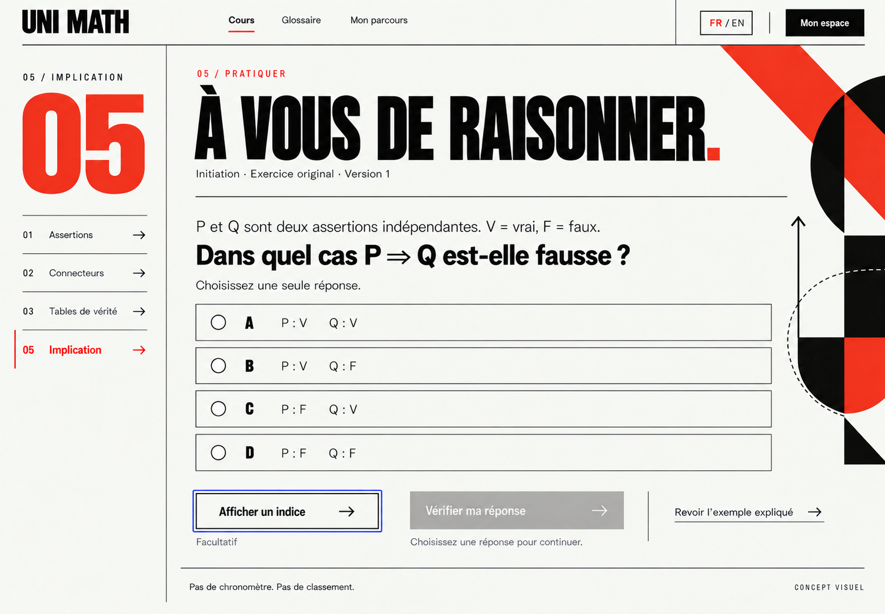
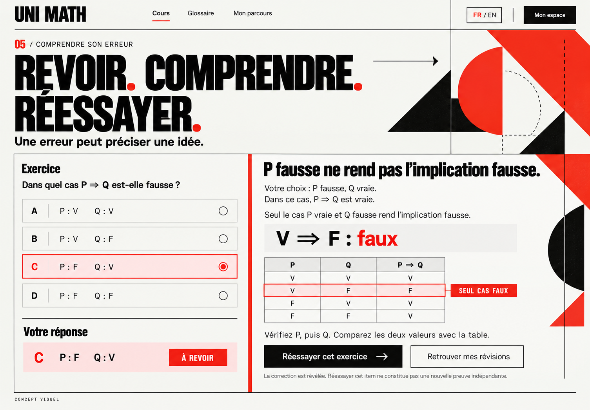
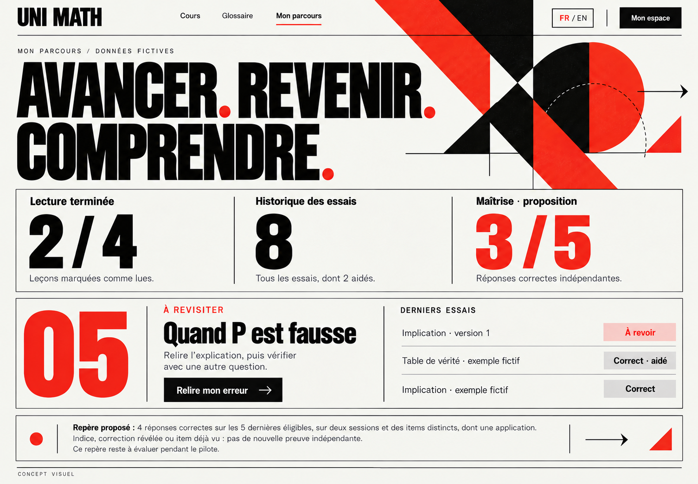
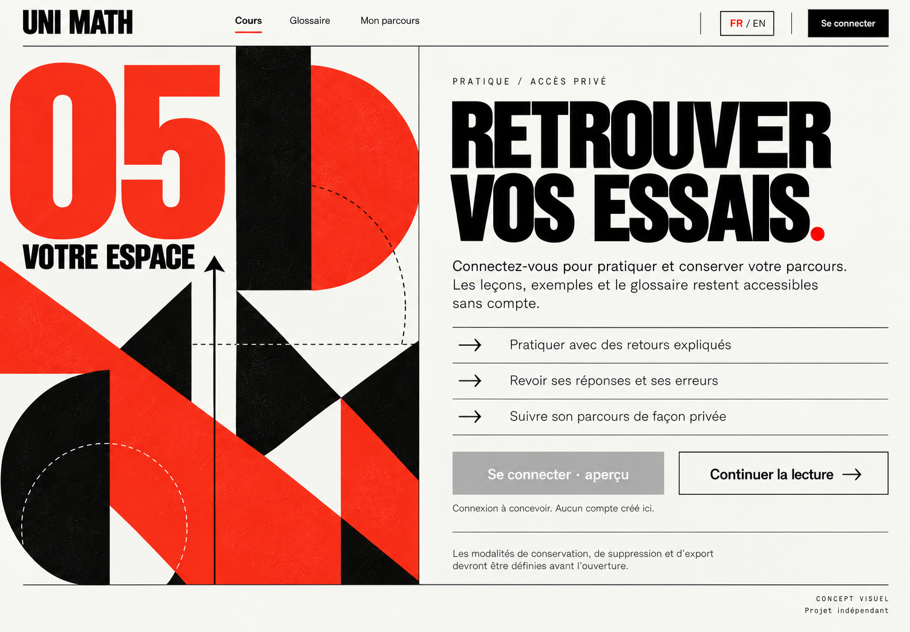
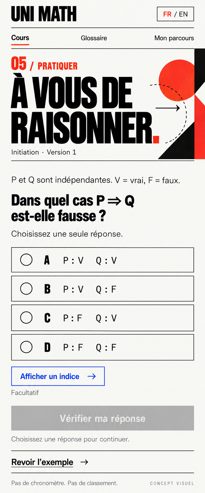

# Signal screen gallery

Status: selected art direction; visual concepts for review. Updated 2026-10-14.

**Signal** brings bold Swiss editorial typography, black rules, vermilion chapter numerals and geometric artwork to Uni Math. The nine selected concepts below replace all previous annotated-notebook proposals.

## Review guide

- [Signal design brief](DESIGN_BRIEF.md)
- [Tokens, components and accessibility intent](DESIGN_SYSTEM.md)
- [Sample mathematics and publication review](CONTENT_REVIEW.md)
- [Constitution-to-design checklist](CONSTITUTION_CHECKLIST.md)
- [Asset validation and conversion](VALIDATION.md)
- [Machine-readable asset evidence](asset-evidence.json)

## Selected screen index

Native image dimensions are listed below; they are not measured CSS viewports. Most screens are French, with paired French/English glossary readings. English page layouts and additional responsive states remain implementation/design follow-up.

| Screen | Language | Composition | Native WebP dimensions |
| --- | --- | --- | --- |
| [Course overview](images/01-signal-overview-fr.webp) | FR | desktop | 1505 × 1045 px |
| [Implication lesson](images/02-signal-lesson-fr.webp) | FR | desktop | 1505 × 1045 px |
| [Worked counterexample](images/03-signal-worked-example-fr.webp) | FR | desktop | 1505 × 1045 px |
| [Bilingual glossary](images/04-signal-glossary-fr.webp) | FR/EN | desktop | 1505 × 1045 px |
| [Unanswered private practice](images/05-signal-practice-fr.webp) | FR | desktop | 1505 × 1045 px |
| [Incorrect-answer feedback](images/06-signal-feedback-fr.webp) | FR | desktop | 1505 × 1045 px |
| [Private progress and mistake review](images/07-signal-progress-fr.webp) | FR | desktop | 1505 × 1045 px |
| [Sign-in gate](images/08-signal-sign-in-gate-fr.webp) | FR | desktop | 1504 × 1046 px |
| [Mobile unanswered practice](images/09-signal-practice-mobile-fr.webp) | FR | mobile | 809 × 1942 px |

## Previews

Homepage caption, practice navigation and progress navigation use their corrected versions. Expand each concept to view it.

01 · Course overview

Approved Signal homepage; material implication caption corrected.

02 · Implication lesson

Domain, definition, necessary/sufficient conditions and four-row truth table.

03 · Worked counterexample

Original n=7 counterexample, with natural numbers including zero.

04 · Bilingual glossary

French/English readings; membership and inclusion separated; French interval preserved.

05 · Unanswered private practice

Final corrected course navigation: 01, 02, 03, 05; no selected answer.

06 · Incorrect-answer feedback

Submitted option C, explicit explanation, sole falsifying row and respectful retry.

07 · Private progress and mistake review

Final corrected chapter 05 and active Mon parcours; all counters fictional.

08 · Sign-in gate

Provider-neutral access concept; return to public reading.

09 · Mobile unanswered practice

Portrait concept intended for 375 px study; not a measured browser viewport.

## What these concepts establish

A selected visual identity and page hierarchy for public reading, worked examples, bilingual notation, private practice, explanatory feedback, progress and access. They do not prove implemented interactions, authentication, grading, responsive geometry, contrast or screen-reader behaviour. The old browser-fixture evidence has been removed.

Next refine heading height and decorative geometry on repeated-task pages, unify component measurements, complete English layouts and implement the documented accessibility/content contracts.
