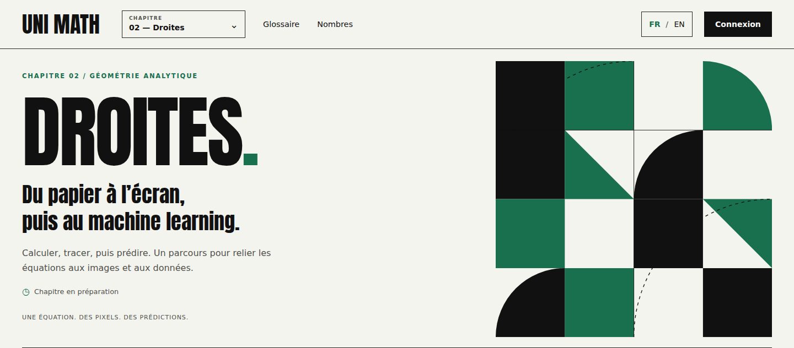

# Selected Chapter 2 design — Décalage in green

Selected by the maintainer on 2026-10-16: **“let's go for 3/decalage green”**. The existing layouts are retained. This pack replaces the earlier figurative hero with the selected abstract artwork in both language studies.

## Visual specification

- Artwork: **03 — Décalage**, original SVG with a `560 × 560` viewBox.
- Accent: **Geometric Green `#18704F`**; paper `#F4F4EF`, ink `#111111`.
- Composition: offset rectangular planes, triangles and quarter-circles; thin rules and sparse dashed arcs.
- Typography, navigation, page structure, content labels and progress presentation: retain the earlier layout study.
- Mobile: retain the existing treatment, hiding the large decorative artwork while keeping the chapter title and green identity.

## Files

| View | French | English |
| --- | --- | --- |
| Desktop, 1440 px | [French](chapter-02-decalage-green-fr-1440.webp) | [English](chapter-02-decalage-green-en-1440.webp) |
| Tablet, 960 px | [French](chapter-02-decalage-green-fr-960.webp) | [English](chapter-02-decalage-green-en-960.webp) |
| Mobile, 375 px | [French](chapter-02-decalage-green-fr-375.webp) | [English](chapter-02-decalage-green-en-375.webp) |
| Small mobile, 320 px | [French](chapter-02-decalage-green-fr-320.webp) | [English](chapter-02-decalage-green-en-320.webp) |

Open selector: [desktop](chapter-02-selector-green-fr-1440.webp) / [mobile](chapter-02-selector-green-fr-375.webp).

Artwork: [editable SVG](chapter-02-decalage-green.svg) / [WebP preview](chapter-02-decalage-green-art.webp).

Standalone HTML studies: [French](chapter-02-fr.html) / [English](chapter-02-en.html). These include design-only interactions and links to existing production resources. They are not implemented Chapter 2 application routes.

## Validation and scope

All eight language/viewport combinations pass loaded-font, green-accent, horizontal-overflow and keyboard open/close checks. The open selector introduces no page overflow. The new hero remains decorative, contains no bitmap or teaching labels, and is hidden from assistive technology. See [validation](validation.json). Actual assistive-technology acceptance remains a future application check.

This is the design-stage snapshot: at selection time only design files and decision notes changed. For current integration and release boundaries, see the [Chapter 2 author review](../../../../content/CHAPTER_02_REVIEW.md) and [content contracts](../../../../CONTENT_RELEASES.md).

To reproduce, run `source/finalize.mjs` with Playwright, Sharp and an installed Chromium (`PLAYWRIGHT_CHROMIUM_EXECUTABLE`). `CODEX_PRIMARY_RUNTIME_NODE_MODULES` may locate the dependencies. Baseline layouts are included. The context studies embed the existing licensed Anton font; see [notices](source/THIRD_PARTY_NOTICES.txt).
